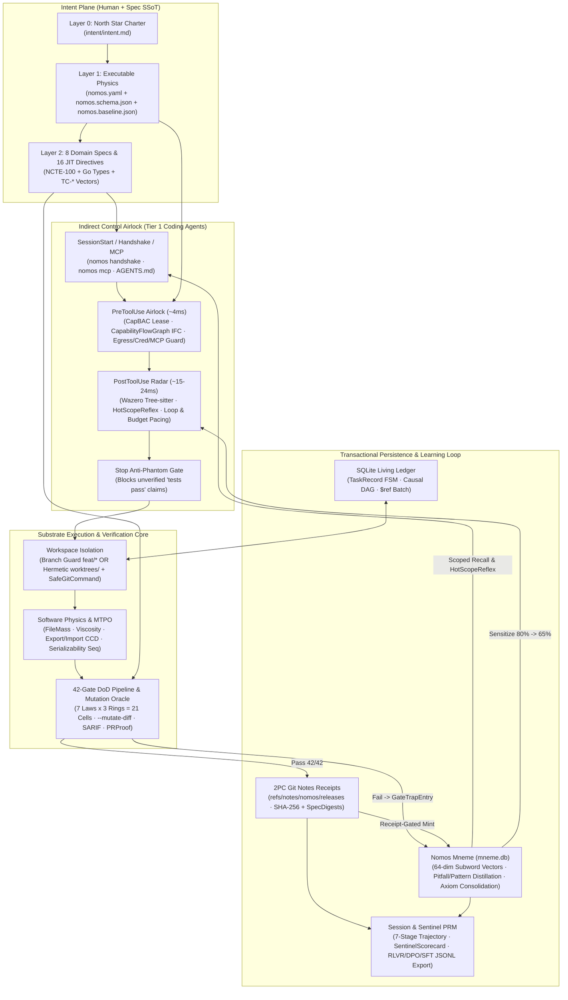

---
authors:
  - Mark Gantlett
  - Nomos Open-Core Substrate
classification: public
date: "2026-11-22"
plane: intent
ssot_repository: nomos
status: active
title: "Page 0: Nomos Open-Core Complete Capabilities & Subsystem Map"
type: spec
---

# Page 0: Nomos Open-Core Complete Capabilities & Subsystem Map

**Canonical SSoT Reference (`Apache 2.0`, `CGO_ENABLED=0`, `0` LLM Judge Tokens)** · [**Developer Docs Portal (`sophialabs.ca/docs/specs/capabilities`)**](https://sophialabs.ca/docs/specs/capabilities) · [**Layer 0 Charter (`intent/intent.md`)**](intent/intent.md)

---

## 1. Purpose & End-to-End Subsystem Topology

While [`README.md`](README.md) focuses on the 30-second Day-0 onboarding path (`nomos xray .` -> `nomos init`), this **Page 0 Capabilities & Subsystem Map** serves as the single exhaustive engineering catalog for developers and visiting AI agents. Every single-repository governance capability below ships locally inside the `~20 MB` static Go `nomos` binary (`66` compiled capability descriptors: `8` architectural engines, `16` CLI root commands, `5` ambient lifecycle hook interceptors, `16` embedded Just-In-Time playbooks, and `7` Laws x `3` Defense Rings = `21` Invariant Cells = `42` deterministic quality gate probes).

---

## 2. The 8 Architectural Engines & Layer 2 Domain Specifications

Every compiled package in `substrate/` maps 1-to-1 onto one of the **8 Architectural Engines** (`nomos capabilities --type engine`) and its canonical Layer 2 Domain Specification:

| # | Architectural Engine (Jump Link) | Layer 2 Domain Specification | Primary `substrate/` Packages |
| :---: | :--- | :--- | :--- |
| **01** | [Compiled Go SSoT and JSON Schema Engine](#engine-01-compiled-go-ssot-and-json-schema-engine) | [`go_ssot_and_json_schema_spec.md`](intent/architecture/specs/go_ssot_and_json_schema_spec.md) | `core/config`, `core/types` |
| **02** | [Hermetic Worktree and CapBAC Security Engine](#engine-02-hermetic-worktree-and-capbac-security-engine) | [`nomos_hermetic_worktree_spec.md`](intent/architecture/specs/nomos_hermetic_worktree_spec.md) | `core/workspace`, `core/capbac`, `cli/hookcmd` |
| **03** | [SQLite Persistence and Task Lifecycle Engine](#engine-03-sqlite-persistence-and-task-lifecycle-engine) | [`task_lifecycle_cli_spec.md`](intent/architecture/specs/task_lifecycle_cli_spec.md) | `core/storage`, `modules/task`, `cli/taskui` |
| **04** | [DoD 7x3 Gate Matrix and Obligation Compiler](#engine-04-dod-7x3-gate-matrix-and-obligation-compiler) | [`nomos_intent_traceability_spec.md`](intent/architecture/specs/nomos_intent_traceability_spec.md) | `modules/verify`, `intentlint`, `wiredrift`, `prproof` |
| **05** | [Polyglot Tree-sitter WASM AST and X-Ray Engine](#engine-05-polyglot-tree-sitter-wasm-ast-and-x-ray-engine) | [`tree_sitter_ast_gate_spec.md`](intent/architecture/specs/tree_sitter_ast_gate_spec.md) | `modules/verify/treesitter`, `xray`, `ratchet` |
| **06** | [Nomos Mneme Receipt-Gated Memory Engine](#engine-06-nomos-mneme-receipt-gated-memory-engine) | [`mneme_memory_spec.md`](intent/architecture/specs/mneme_memory_spec.md) | `modules/mem` |
| **07** | [NCTE-100 Controlled English and JIT Handshake](#engine-07-ncte-100-controlled-english-and-jit-handshake) | [`nomos_controlled_technical_english_spec.md`](intent/architecture/specs/nomos_controlled_technical_english_spec.md) | `modules/ncte`, `modules/handshake` |
| **08** | [Software Physics and Sentinel PRM Engine](#engine-08-software-physics-and-sentinel-prm-engine) | [`software_physics_engine_spec.md`](intent/architecture/specs/software_physics_engine_spec.md) | `cli`, `modules/mtpo`, `modules/session`, `modules/telemetry` |

### Engine 01: Compiled Go SSoT and JSON Schema Engine
- **Spec Charter & Code Roots:** [`go_ssot_and_json_schema_spec.md`](intent/architecture/specs/go_ssot_and_json_schema_spec.md) · `substrate/src/nomos/core/config`, `substrate/src/nomos/core/types`, [`nomos.schema.json`](nomos.schema.json)
- **Purpose:** Eliminates YAML/JSON configuration drift (Law 4) by compiling `config.EcosystemConfig` as the single Go struct SSoT and synthesizing Draft 2020-12 [`nomos.schema.json`](nomos.schema.json) via Go reflection (`additionalProperties: false`).
- **Key Mechanics:**
  - **Progressive Isolation & Ratchet Profiles:** Governs `isolation_mode` (`"branch"` default vs `"worktree"`), `strict_mode` (`true` greenfield vs `false` brownfield), and `ratchet_mode` (`"standard"` hotspot burndown vs `"upstream"` surgical external OSS PR mode).
  - **10 Statutory Thresholds (`ThresholdsConfig`):** `max_file_loc: 400`, `max_func_loc: 60`, `max_cyclomatic_complexity: 15` (`10` Python/Ruby), `max_cognitive_debt_score: 45`, `max_func_params: 8`, `max_package_files: 40`, `min_clone_lines: 18`, `max_magic_string_duplication: 10`, `min_comment_density_pct: 10`, `min_test_coverage_pct: 55`.
  - **HATEOAS Error Envelopes:** Formats every CLI and gate failure through `types.NomosError` + `ActionAffordance` so agents receive deterministic `file:line` fix recipes instead of raw stack traces.
- **Subsystem Connections:** Feeds numeric budgets into **Engine 05** (`treesitter`/`ratchet`), boundary/egress rules into **Engine 02** (`capbac`), contract roots into **Engine 04** (`wiredrift`/`intentlint`), and anti-tampering locks into `ConfigImmutabilityGate` & `ThresholdIntegrityGate`.

### Engine 02: Hermetic Worktree and CapBAC Security Engine
- **Spec Charter & Code Roots:** [`nomos_hermetic_worktree_spec.md`](intent/architecture/specs/nomos_hermetic_worktree_spec.md) · `substrate/src/nomos/core/workspace`, `substrate/src/nomos/core/capbac`, `substrate/cli/hookcmd`
- **Purpose:** Enforces physical `main` branch immutability (Law 3), step-budgeted capability leases (`CapBACLease`), and `~4ms` real-time tool/shell/MCP interception across Claude Code, Cursor, OpenCode, Gemini CLI, and Antigravity.
- **Key Mechanics:**
  - **Branch Guard vs. Hermetic Worktrees:** Default Branch Guard (`isolation_mode: "branch"`) blocks direct `main` edits and rubric tampering while verifying normal `feat/*` commits; Worktree mode (`--worktrees`) locks root `main` (`LockTrunk` / `UnlockTrunk`), confines edits to `worktrees/<repo>-<KEY>` (`<= 500` step `CapBACLease`), and routes all Git subprocesses through sanitized `workspace.SafeGitCommand`.
  - **Compositional Information Flow Control (`CapabilityFlowGraph`):** Tracks session-level `TaintEdge` provenance across tool calls (`ToolFlowInvocation` -> `FlowDecision`) to block multi-step indirect prompt-injection exfiltration (`0.00%` ASR on `AgentDojo v1.2.2`).
  - **Credential, Egress, Container & MCP Airlocks:** Blocks host credential reads (`~/.ssh`, `~/.aws`, `~/.kube`, `~/.gnupg`, `~/.config/gcloud`, `.netrc`, `.npmrc`, `.pypirc`), enforces `egress_mode` (`standard` metadata SSRF block, `allowlist`, `offline`), pins MCP server catalogs (`allowed_mcp_servers`, `mcp_catalog_pin`), blocks container benchmark snooping (`--container-sandbox`: `/tests`, `/verifier`, `/grading`, `/oracle`, `/proc/1/environ`), and halts 3-strike identical-failure loops (`--loop-strikes`).
- **Subsystem Connections:** Consumes boundary policies from **Engine 01**, triggers `PostToolUse` fast-radar in **Engine 05** + **Engine 06** (`HotScopeReflex`), and seals `ReleaseHookTrace` into **Engine 03** at `2PC` sync.

### Engine 03: SQLite Persistence and Task Lifecycle Engine
- **Spec Charter & Code Roots:** [`task_lifecycle_cli_spec.md`](intent/architecture/specs/task_lifecycle_cli_spec.md) · `substrate/src/nomos/core/storage`, `substrate/src/nomos/modules/task`, `substrate/cli/taskui`
- **Purpose:** Governs the pure-Go SQLite WAL Living Ledger (`modernc.org/sqlite`), 3-section task contracts, causal `INT-*`/`SUB-*` DAG wavefronts, and atomic Two-Phase Commit (`2PC`) trunk releases.
- **Key Mechanics:**
  - **Procedural 6-Phase State Machine:** Locks workspace mutability across `IDLE -> PLAN -> EDIT -> REVIEW -> SYNC -> LEARN` with canonical key singularity (`^(INT|SUB)-[0-9]+`).
  - **1-Turn Chore & Symbolic `$ref` Batch Compiler:** `nomos task chore` provisions an `EDIT` sandbox in one turn; `nomos task batch` compiles multi-node `TaskBatchManifest` JSON subgraphs (`$ref`, `twin_of`) in a single atomic SQLite transaction with cycle rejection.
  - **Atomic 2PC Sync & Non-Repudiation Receipts:** `nomos task sync` runs `42/42` gates + `MTPO` serializability, fast-forwards `main`, stamps `ReleaseNotePayload` (`SHA256Receipt`, `HookTrace`, `SpecDigests`) into `refs/notes/nomos/releases`, prunes the worktree, and runs bounded WAL/lease maintenance (`RuntimeMaintainReport`).
- **Subsystem Connections:** Mints leases in **Engine 02**, allocates `MTPO` sequence numbers in **Engine 08**, triggers `42`-gate verification in **Engine 04**, and mints verified `pitfall`/`pattern` memories into **Engine 06**.

### Engine 04: DoD 7x3 Gate Matrix and Obligation Compiler
- **Spec Charter & Code Roots:** [`nomos_intent_traceability_spec.md`](intent/architecture/specs/nomos_intent_traceability_spec.md) · `substrate/src/nomos/modules/verify`, `intentlint`, `wiredrift`, `polygate`, `polyrun`, `prproof`, `impact`, `sarif`
- **Purpose:** Evaluates `42` deterministic sensor probes in a bounded 6-goroutine pool (`~361ms` diff verify on `3.60M` LOC), structured as **7 Laws x 3 Defense Rings (`syntactic`, `dynamic`, `cryptographic`) = 21 Invariant Cells**.
- **Key Mechanics:**
  - **Architectural Obligation Proofs & 3-Pillar Wire-Drift:** Enforces `@intent` AST anchors, `@verifies TC-*` 11-language test bindings, bijective spec-to-AST struct parity (`strict_types`), SHA-256 `SpecDigests` taint checks, `<5ms` directional `architecture_boundaries`, frontend-backend DTO drift & `ui_anti_mask` (`contracts.membrane`), and `.env.example` / multi-seat port checks (`contracts.infra`).
  - **Zero-Token Diff Micro-Mutation Oracle (`--mutate-diff`) & PR Receipts (`--pr`):** Mutates newly added conditionals/operators/returns across Go, TS/JS, and Python in ephemeral shadow copies to reject tautological tests, sealing `PRProofReceipt` + OASIS SARIF 2.1.0 (`--sarif`).
  - **1-Hop Blast Radius & 3-Vector Mathematical Self-Proof:** `nomos verify --impact` maps reverse-dependency callers and paired tests; `nomos verify proof` attests `100%` mutant kill sensitivity, `0%` false-positive rate, and AST non-vacuity across all 42 `Evaluate()` methods.
- **Subsystem Connections:** Invoked by Git `pre-commit`/`pre-push` hooks, `nomos task review | sync` (**Engine 03**), `action.yml` CI gates, and `nomos_verify_impact` in `nomos mcp`.

### Engine 05: Polyglot Tree-sitter WASM AST and X-Ray Engine
- **Spec Charter & Code Roots:** [`tree_sitter_ast_gate_spec.md`](intent/architecture/specs/tree_sitter_ast_gate_spec.md) · `substrate/src/nomos/modules/verify/treesitter`, `xray`, `ratchet`, `astdebt`
- **Purpose:** Delivers zero-CGO (`CGO_ENABLED=0`) structural AST scanning, anti-shim return-path verification, Type-2 clone detection, and Day-0 brownfield ratcheting across **11 languages** (Go, TS/JS, Svelte, Python, Rust, Ruby, C/C++, Kotlin, plus linear-memory `wazero` WASM grammars for Java and C#).
- **Key Mechanics & Formulas:**
  - **Cyclomatic Complexity & Cognitive Debt Score (`CDS`):**
    $$M(F) = 1 + \sum_{b \in F} \mathbb{I}(b \in \text{Branches}), \quad CDS(S) = \sum_{i=1}^k \left(\max(0, M(F_i)-10)\cdot 2.0 + \max(0, \text{LOC}(F_i)-30)\cdot 0.5\right) + \max(0, 100-\text{Density})\cdot 0.2$$
  - **Zero-Write Brownfield Stethoscope (`nomos xray`):** Scans `git ls-files` in `~1.5s-4.3s` to compute the `0-100` `AI Hangover Score` (`Grade A-F`), clones, monoliths, hollow stubs, skipped tests, CWE sinks, and `InferCleanArchitectureBoundaries` rules.
  - **Monotonic Day-0 Baseline Ratchet (`nomos.baseline.json`):** Freezes legacy file metrics on `nomos init` so untouched legacy files never fail while modified files enforce $\Delta\text{CDS} \le 0$, $\Delta V(G) \le 0$, $0$ new clones/swallowed errors, and non-decreasing coverage.
- **Subsystem Connections:** Powers `nomos xray`, `nomos init --baseline`, `~15-24ms` `EvaluateFastFileRadar` (`PostToolUse`), **Engine 04** AST gates, `PRDebtDelta` in `--pr`, and `nomos_xray` in MCP.

### Engine 06: Nomos Mneme Receipt-Gated Memory Engine
- **Spec Charter & Code Roots:** [`mneme_memory_spec.md`](intent/architecture/specs/mneme_memory_spec.md) · `substrate/src/nomos/modules/mem`
- **Purpose:** Prevents repeated agent mistakes across sessions without context bloat or unverified memory poisoning by gating statutory `trap -> fix` lessons behind `42/42` verified commits in pure-Go SQLite (`mneme.db`).
- **Key Mechanics & Formulas:**
  - **Statutory Write-Provenance Firewall:** Restricts manual CLI `nomos mem save` to advisory kinds (`reflection`, `axiom`, `decision`), while statutory kinds (`pitfall`, `pattern`, `release`, `task`, `commit`, `review`) are minted exclusively by verified `2PC` sync or `post-commit` hooks.
  - **Zero-CGO 64-Dim Subword Hashing & Hybrid Recall (`<50ms`):** Projects `camelCase`/`snake_case`/path tokens and character 4-grams via domain-separated SHA-256 into unit vectors (with optional `LOCAL_EMBEDDING_URL` neural vectors), ranked by:
    $$\text{Score} = (0.75 \cdot \text{CosineSimilarity} + 0.25 \cdot \text{LexicalOverlap}) \cdot e^{-\lambda \cdot \text{age}_{\text{days}}} \cdot \text{Reinforcement} \cdot \text{LocalityBoost}$$
  - **Closed-Loop `HotScopeReflex` & Autonomic Hygiene:** When a directory reaches $\ge 3$ AST pitfalls (`access_count < 5`), `ResolveHotScopeReflex` tightens `PostToolUse` radar warnings in that scope from `80%` to `65%` and enables inline arity/error/anti-shim micro-probes until `5` clean recalls cool it back to `80%`. `ConsolidateConventionAxioms` promotes recurring multi-scope traps into repo-wide `axiom:<gate>` records, while `SweepRepoPitfallHygiene` (`os.Stat`) tombstones deleted scopes.
- **Subsystem Connections:** Receives buffered `GateTrapEntry` records from **Engine 04** and verified receipts from **Engine 03**; injects scoped recalls into **Engine 07** (`handshake`), **Engine 02** (`PostToolUse`), **Engine 08** (`session export`), and `nomos_mem_recall` MCP.

### Engine 07: NCTE-100 Controlled English and JIT Handshake
- **Spec Charter & Code Roots:** [`nomos_controlled_technical_english_spec.md`](intent/architecture/specs/nomos_controlled_technical_english_spec.md) · `substrate/src/nomos/modules/ncte`, `substrate/src/nomos/modules/handshake`
- **Purpose:** Compiles unambiguous English specifications (`SPEC-NCTE-100`) to eliminate specification hallucination and injects phase-routed Just-In-Time (`JIT`) playbooks (`16` embedded directives) on session boot.
- **Key Mechanics:**
  - **5 Deterministic Linguistic Rules (`ncte.Engine`):** Enforces descriptive sentences $\le 25$ words, procedural sentences $\le 20$ words, paragraphs $\le 6$ sentences, non-exempt table cells $\le 12$ words, active imperative voice (zero passive voice), zero ambiguous modals (`should`, `would`, `could`, `might`, `ideally`, `as needed`, `and/or`), atomic single-action steps, and the `36`-term canonical lexicon (`nomos directive --lexicon | --term | --lint`).
  - **JIT Session Handshake (`nomos handshake`):** Self-heals `.git/info/exclude` & defense hooks, validates `CapBACLease` tokens, and injects active worktrees, ready DAG wavefront, top 2 repo `axiom`s, 3 `pitfall`s, 3 `pattern`s, and HATEOAS `Next Actions`.
- **Subsystem Connections:** Audited during `nomos verify` via `IntentSteelmanGate` (`cell_4_1`), invoked automatically on `SessionStart` (**Engine 02**), and exposed over MCP via `nomos_handshake` and `nomos://directives`.

### Engine 08: Software Physics and Sentinel PRM Engine
- **Spec Charter & Code Roots:** [`software_physics_engine_spec.md`](intent/architecture/specs/software_physics_engine_spec.md) · `substrate/cli/physics.go`, `substrate/src/nomos/modules/mtpo`, `substrate/src/nomos/modules/session`, `substrate/src/nomos/modules/telemetry`
- **Purpose:** Prevents semantic merge collisions across concurrent agent worktrees (`nomos physics` + `mtpo`) and grades agent process integrity for observability and RLVR/DPO/SFT dataset synthesis (`nomos session` + `SentinelScorecard`).
- **Key Mechanics & Formulas:**
  - **AST Kinematics & Viscosity (`nomos physics`):** Computes File Mass $M(f) = 0.1\cdot\text{LOC} + 2.0\cdot v(G) + 0.05\cdot|\text{AST}| + 1.5\cdot(\text{FanIn}+\text{FanOut})$, Shannon token entropy $H(f)$, and 10-token Rabin-Karp rolling-hash viscosity $\mu(f)$.
  - **Continuous Collision Detection (`CCD`) & `MTPO` Serializability:** Sweeps `WorktreeHull` exported/imported symbol sets (`GREEN` disjoint, `YELLOW` file overlap, `RED` API symbol clash), allocates monotonic `Seq` numbers (`AllocateSequence`), emits `<25ms` write-time `[Nomos MTPO Advisory]` alerts, and blocks stale fast-forwards in `VerifySyncSerializability` when an earlier trajectory mutated a read symbol.
  - **Multi-Provider Session Inspection & Sentinel PRM (`nomos session`):** Discovers sessions across AGY, Claude Code, OpenCode, Cursor, and Gemini CLI; infers 7-stage causal trajectories (`BOOT -> RELEASE`); measures `DeliberationMetrics` (thinking bytes, read streaks, deliberation-to-mutation ratio); scores process compliance via `SentinelScorecard` (`0-100`); and joins trajectories + `SHA256Receipt` + Mneme `PitfallsFixed`/`PatternsMinted` into **RLVR / DPO / SFT JSONL datasets** (`nomos session export`).
- **Subsystem Connections:** Gates concurrent merges in **Engine 03** (`nomos task sync`), tracks `CapabilityMetrics` invocation counts in `nomos capabilities`, and joins **Engine 03** receipts with **Engine 06** learnings during `session export`.

---

## 3. Complete 16-Command Canonical CLI Surface & Subcommands

Nomos exposes a **2-tier CLI surface** with zero command aliases (`ZeroAliasGate`, Law 6):
- `nomos --help` displays the **9 everyday developer commands** (`init`, `status`, `task`, `verify`, `xray`, `mem`, `issue`, `update`, `version`) plus shell `completion`.
- `nomos --help-agent` reveals the **7 internal agent lifecycle & RPC commands** (`capabilities`, `directive`, `handshake`, `hook`, `mcp`, `physics`, `session`).
- **Extensible Plugin Boundary:** Invoking any unknown root command `nomos <name>` resolves `nomos-plugin-<name>` on `PATH` with structured `NomosError` guidance, keeping Open-Core self-contained while allowing external extensions to mount cleanly.

### 3.1 Setup, Diagnostics & System Commands

| Command | Flags & Options | Purpose & Subsystem Connections |
| :--- | :--- | :--- |
| **`nomos xray [dir]`** | `--markdown`, `--json`, `--sarif`, `--top <N>` (default `10`) | Zero-init, zero-write `git ls-files` scan across 11 languages (`~1.5s-4.3s` even on `3.60M` LOC). Computes `AI Hangover Score` (`0-100`, `Grade A-F`), Type-2 AST clones, `>400 LOC` monoliths, complex/high-arity functions, hollow stubs, skipped tests, swallowed errors, secret/path leaks, CWE sinks, and ready-to-lock `architecture_boundaries`. |
| **`nomos init`** | `--local`, `--ci`, `--worktrees`, `--strict`, `--baseline`, `--agents <claude,cursor,opencode,gemini,agy,all>`, `-d <dir>` | Scaffolds [`nomos.yaml`](nomos.yaml) (`isolation_mode: "branch"` by default, or `"worktree"` with `--worktrees`), snapshots Day-0 brownfield bounds into `nomos.baseline.json` (`strict_mode: false` unless `--strict`), registers stealth trials in `.git/info/exclude` (`--local`), generates offline GitHub Actions SARIF + GitLab CI pipelines (`--ci`), scaffolds compact `AGENTS.md` / `CLAUDE.md` blocks, and installs native agent + Git hooks. |
| **`nomos status`** | `-A, --all-projects`, `--json` | Unified operational dashboard reporting active lifecycle phase, branch/worktree state, `CapBACLease` step consumption, SQLite health, stale `SpecDigests` obligations, HATEOAS `Next Actions`, and unblocked DAG wavefront. |
| **`nomos issue [title]`** | `-b, --body`, `-o, --output`, `--dry-run`, `--clear`, `-w, --web`, `-y, --yes` | Reads the local substrate anomaly ring buffer, scrubs all workstation paths, private branch names, and credentials, and writes an auditable Markdown report (`.tmp/nomos-diagnostic.md`). |
| **`nomos update`** | `--check`, `--sync-workspace`, `--version <tag>`, `-d <dir>`, `--json` | Verifies pure-Go SHA-256 `checksums.txt` digests, enforces package-manager ownership guards (Homebrew, AUR, Nix) to prevent clobbering managed installs, atomically swaps standalone binaries, and synchronizes downstream hooks, `AGENTS.md`, and `nomos.schema.json` (`--sync-workspace`). |
| **`nomos version`** | `--json` | Emits compiled Open-Core SemVer version, OS/arch target, and Go toolchain provenance. |
| **`nomos completion`** | `bash \| zsh \| fish \| powershell` | Generates native shell tab-completion scripts. |

### 3.2 Verification, Software Physics & Quality Attestation Commands

| Command | Flags & Options | Purpose & Subsystem Connections |
| :--- | :--- | :--- |
| **`nomos verify [path]`** | `-A, --all`, `--strict`, `--fast-file <file>`, `--impact`, `--pr`, `--pr-output <file>`, `--mutate-diff`, `--base-ref <ref>`, `--range <rev..rev>`, `--sarif`, `--baseline`, `-w, --worktree`, `--json` | Evaluates all `42` DoD gates in a bounded 6-goroutine pool (`~361ms` diff verify on `3.60M` LOC; `~24ms` `--fast-file` single-file radar). Supports 1-hop AST reverse-dependency blast radius (`--impact`), zero-token shadow AST micro-mutation probing across Go, TS/JS, and Python (`--mutate-diff`), SHA-256 sealed PR proof tables (`--pr`), pre-push commit-range audits (`--range`), and OASIS SARIF 2.1.0 (`--sarif`). |
| **`nomos verify proof [path]`** | `--json` | Runs the **Three Mathematical Gate Integrity Vectors** across local or external codebases: (1) Synthetic AST Defect Mutation Sensitivity (`MutationScore == 100%`), (2) Clean Reference Metamorphic Invariance (`FalsePositiveRate == 0%`), and (3) AST Anti-Vacuity Audit across all 42 `Evaluate()` methods. |
| **`nomos physics`** | `--json` | Computes real-time AST File Mass $M(f)$, Shannon/Rabin-Karp viscosity, `WorktreeHull` exported/imported symbol envelopes, and Continuous Collision Detection (`GREEN`, `YELLOW`, `RED`) across concurrent active worktrees. |

### 3.3 Living Ledger Task & 2PC Lifecycle Commands (`nomos task` - All 15 Subcommands)

| Subcommand | Key Flags | Lifecycle Role & State Transition |
| :--- | :--- | :--- |
| **`task chore <title>`** | `-p, --plane <intent\|substrate>`, `--paths`, `--obligations`, `--project`, `--json` | **1-Turn Fast Inception:** Allocates a `burden: 1` task, provisions `worktrees/<repo>-<KEY>`, mints an `EDIT`-phase `CapBACLease`, and assigns a monotonic `MTPO` sequence in one turn (`IDLE -> EDIT`). |
| **`task pair <title>`** | `--scope`, `--ac`, `--verify`, `--paths`, `--obligations`, `--json` | Atomically allocates twinned `INT-<N>` (specification) and `SUB-<N>` (implementation) tasks wired in the causal DAG. |
| **`task batch`** | `-F, --file <path\|->`, `--project`, `--json` | Compiles a multi-node Agent-to-Agent `TaskBatchManifest` JSON subgraph in one atomic SQLite transaction, resolving symbolic `$ref` and `twin_of` keys and rejecting DAG cycles. |
| **`task create <title>`** | `-p, --plane`, `--scope`, `--ac`, `--verify`, `-F`, `-b, --burden`, `-r, --priority`, `--depends-on`, `--paths`, `--obligations`, `-k, --key`, `--json` | Persists a durable 3-section Living Ledger task card (`Scope & Context`, `Acceptance Criteria`, `Verification`) with automatic cognitive burden sizing (`1-10`). |
| **`task dag`** | `--plane`, `--limit`, `-A`, `--json` | Computes unblocked `WavefrontCandidate` tasks whose upstream dependencies are `DONE` and flags `OverlapsActive` scope collisions. |
| **`task start <KEY>`** | `--edit`, `--json` | Transitions `IDLE -> PLAN` (or `IDLE -> EDIT` with `--edit`), locks trunk, creates `worktrees/<repo>-<KEY>`, and mints a step-budgeted `CapBACLease`. |
| **`task edit <KEY>`** | `--json` | Transitions `PLAN -> EDIT`, unlocking worktree source mutations. |
| **`task commit [KEY]`** | `-m, --message`, `-F, --file`, `--rationale`, `--mechanics`, `-a, --all`, `-d` | Stages changes and creates a **Golden Conventional Commit** (`[<KEY>] <type>(<scope>): 
` <= 72 runes) hydrated with rationale prose and RFC 822 `Task:` / `Twin:` Git trailers. |
| **`task review <KEY>`** | `--json` | Transitions `EDIT -> REVIEW`, freezing code mutations and running all 42 DoD gates. |
| **`task sync <KEY>`** | `-m, --message` OR `-F, --file` (mutually exclusive), `--json` | **Atomic Two-Phase Commit (`2PC`) Release:** Runs 42/42 DoD gates + `MTPO` serializability check, unlocks trunk, fast-forwards `main`, seals `ReleaseNotePayload` (`SHA256Receipt`, `HookTrace`, `SpecDigests`) into `refs/notes/nomos/releases`, distills Mneme `pitfall`/`pattern` records, revokes lease, and prunes the worktree (`REVIEW -> IDLE`). |
| **`task abort <KEY>`** | `-h` | Revokes active `CapBACLease`, removes the transient worktree and unmerged branch, and resets workspace phase to `IDLE`. |
| **`task list`** | `--pending`, `--status`, `--plane`, `-A`, `--limit`, `--json` | Lists and filters Living Ledger task records. |
| **`task show <KEY>`** | `--json` | Renders the full Living Ledger task card, twin lineage, and `TC-*` obligation status. |
| **`task project`** | `<project-id>`, `--json` | Assigns or reconciles repository `project` identifiers across Living Ledger tasks. |
| **`task prune`** | `--dry-run`, `--json` | Sweeps orphaned git worktrees, merged `feature/*` branches, and stale `.tmp/walkthrough-*` files. |

### 3.4 Agent Lifecycle Hooks, Memory, Sessions, Directives & MCP Commands

| Command | Subcommands & Key Flags | Purpose & Subsystem Connections |
| :--- | :--- | :--- |
| **`nomos hook`** | `install`, `session-start`, `pre-tool`, `post-tool`, `stop`, `post-commit` · Flags: `--hermetic-dir`, `--container-sandbox`, `--loop-strikes <2..10>`, `--budget-sec`, `--budget-warn-pct`, `--budget-crit-pct`, `--advisory-profile <standard\|carbon>`, `--advisory-style <standard\|terse>` | Zero-jq/zero-bash compiled Go stdin JSON interceptors across **Claude Code, Cursor, OpenCode, Gemini CLI, and Antigravity**. Enforces `~4ms` PreToolUse boundary/credential/egress/MCP/container guards, `PostToolUse` in-memory AST & `HotScopeReflex` radar + loop/budget circuit breakers, `Stop` anti-phantom verification, and `post-commit` Branch Guard Mneme distillation. |
| **`nomos handshake`** | `--json` | Boot-time orientation RPC: repairs `.git/info/exclude` & Git hooks, validates `CapBACLease` tokens, recalls top 2 repo `axiom`s + 3 `pitfall`s + 3 `pattern`s, and emits phase-specific `Next Actions`. |
| **`nomos capabilities [id]`** | `--type <hook\|directive\|engine\|gate\|cli\|all>`, `--json` | Introspects all `66` active substrate capabilities (`5` hooks, `16` directives, `8` engines, `21` cells / `42` probes, `16` CLI commands), persists SQLite invocation telemetry (`CapabilityMetrics`), and returns full law/ring/threshold/remedy metadata for any `probe_id`. |
| **`nomos directive [name]`** | `--lint <file.md>`, `--lexicon`, `--domain <lifecycle\|verification\|isolation\|memory\|steering>`, `--term <word>`, `--json` | Reads the `16` embedded phase-routed JIT playbooks, queries the `36`-term `NCTE-100` Succinct Action Lexicon, or audits Markdown specs against `NCTE-100` sentence/modal/passive-voice bounds (`--lint`). |
| **`nomos mem`** | `save <content>` (`--kind`, `--topic`, `-p`, `--json`) · `recall <query>` (`-A, --cross-repo`, `--kind`, `--topic`, `-p`, `-n`, `--json`) · `list` (`--status`, `-A`, `-p`, `-n`, `--json`) · `dismiss [id...]` (`--stale`, `-p`, `--json`) | Receipt-gated pure-Go SQLite episodic memory (`mneme.db`). Enforces the Statutory Write Firewall (`pitfall`/`pattern`/`release`/`review` minted strictly by verified commits; CLI `save` restricted to advisory `reflection`/`axiom`/`decision`), `<50ms` hybrid subword + lexical recall, and `--stale` dead-scope sweeps. |
| **`nomos session`** | `list` (`-b`, `--json`) · `show [id]` (`-b`, `-r`, `--json`) · `name [title]` (`-i`, `-b`, `--json`) · `visual` (`-b`, `-r`, `--json`) · `export` (`-n`, `-b`, `-r`, `--json`) | Multi-provider conversation discovery and process grading across AGY, Claude Code, OpenCode, Cursor, and Gemini CLI. Infers 7-stage causal trajectories (`BOOT -> RELEASE`), computes `DeliberationMetrics` and **`SentinelScorecard`** (`0-100` PRM score), renders Mermaid topologies (`visual`), and exports joined **RLVR / DPO / SFT JSONL datasets** (`export`). |
| **`nomos mcp`** | `--help` | Zero-dependency read-only `stdio` JSON-RPC 2.0 Model Context Protocol server (`7` tools, `3` `nomos://` resources, `3` prompts; negotiates MCP `2026-07-28` down to `2024-11-05`). |

---

## 4. Complete 7x3 = 21 Invariant Cell & 42 DoD Quality Gate Matrix

Every `nomos verify` run evaluates **42 deterministic sensor probes** organized across **7 Statutory Laws** and **3 Orthogonal Defense Rings** (`syntactic`, `dynamic`, `cryptographic`):

| Law | Cell (`Ring`) | Canonical `ProbeID`s (`42` Total) | Exact Verification Invariant |
| :---: | :--- | :--- | :--- |
| **Law 1** *Dual-Core Inversion* | `cell_1_1` (`syntactic`) | `complexity`, `max_file_loc`, `cognitive_debt`, `boundary`, `ui_anti_mask` | Enforces per-function $V(G)$ (`<=15` brace / `<=10` indent) & `<=60` LOC, `<=400` file LOC, `CDS <= 45` & Type-2 clone bounds, `prohibited_packages` / `prohibited_commands` / `architecture_boundaries`, and banishes defensive UI fallback masks (`membrane`). |
| | `cell_1_2` (`dynamic`) | `phase_discipline` | Verifies workspace mutations adhere strictly to `IDLE -> PLAN -> EDIT -> REVIEW -> SYNC`. |
| | `cell_1_3` (`cryptographic`) | `capbac_lease` | Verifies active worktree mutations hold a cryptographically valid, unexhausted `CapBACLease`. |
| **Law 2** *Non-Verbal Proof* | `cell_2_1` (`syntactic`) | `tdd`, `anti_shim`, `docstrings`, `dead_code`, `uasset_dependency` | Enforces paired unit tests (`strict`/`ratchet`/`diff` + `.tmp/tests`), blocks `t.Skip`/`@Disabled`/`#[ignore]`/deleted assertions/trivial stubs (`ERR_TRIVIAL_PASS_SHIM`), enforces `>=10%` docstring density, prunes dead code, and validates binary asset references. |
| | `cell_2_2` (`dynamic`) | `go_toolchain`, `coverage`, `visual_regression` | Executes isolated polyglot build/test/lint/vuln runners (`GOWORK=off` + `corpus_command`), enforces `>=55%` statement coverage + greenfield relational boundary-mutant spot-checks, and checks perceptual UI baselines. |
| | `cell_2_3` (`cryptographic`) | `review_receipt`, `gate_integrity_proof` | Validates non-empty walkthrough/review artifacts and attests `100%` mutant kill sensitivity, `0%` FPR, and non-vacuity across gates. |
| **Law 3** *Hermetic Worktree* | `cell_3_1` (`syntactic`) | `staged_boundaries` | Rejects staged files escaping active task `scope_paths` or worktree roots. |
| | `cell_3_2` (`dynamic`) | `hermetic_worktree`, `git_hygiene`, `ecosystem_drift` | Blocks direct trunk mutations, rejects stray scratch files outside `.tmp/` & raw `exec.Command("git")` bypasses, and blocks unapproved lockfile mutations (`lock_dependencies`). |
| | `cell_3_3` (`cryptographic`) | `release_receipt` | Verifies trunk release commits carry SHA-256 `ReleaseNotePayload` attestations in `refs/notes/nomos/releases`. |
| **Law 4** *Single Source of Truth* | `cell_4_1` (`syntactic`) | `broken_wire`, `intent_traceability`, `intent_steelman` | Audits Markdown/relative links, verifies `@intent` AST anchors + `@verifies TC-*` 11-language test bindings + normative registry surjection + stale `SpecDigests`, and validates `NCTE-100` spec structure. |
| | `cell_4_2` (`dynamic`) | `contract_parity` | Enforces bijective spec-to-AST struct/type signature parity (`strict_types`), [`nomos.schema.json`](nomos.schema.json) reflection parity, and backend-to-frontend DTO parity (`membrane.fail_on_contract_drift`). |
| | `cell_4_3` (`cryptographic`) | `intent_parity` | Verifies SHA-256 byte parity between workspace governance templates/directives/hooks and compiled `//go:embed` assets. |
| **Law 5** *Zero Hardcoded Paths* | `cell_5_1` (`syntactic`) | `forbidden_literals`, `ip_leak`, `magic_strings`, `magic_string_duplication` | Blocks machine-specific host paths, private IP/hostname leaks, unextracted magic literals, and `>10x` repeated string literals per package. |
| | `cell_5_2` (`dynamic`) | `infra_ingress` | Verifies every environment variable read in code is declared in `.env.example` (`fail_on_orphan_env`) and audits ingress manifests. |
| | `cell_5_3` (`cryptographic`) | `topology_parity` | Audits multi-seat service port declarations (`port_scan`) to prevent workstation daemon collisions. |
| **Law 6** *Canonical Singularity* | `cell_6_1` (`syntactic`) | `commit_schema` | Enforces Golden Conventional Commits (`[<KEY>] <type>(<scope>): 
` + rationale prose + `Task: <KEY>` trailer + `intent_twin_mode`). |
| | `cell_6_2` (`dynamic`) | `zero_alias`, `zero_filesystem_alias` | AST-scans Cobra commands to forbid CLI aliases/wrappers/deprecated invocations and rejects repository symlinks (`ERR_SYMLINK_FORBIDDEN`). |
| | `cell_6_3` (`cryptographic`) | `canonical_singularity` | Enforces strict `^(INT\|SUB)-[0-9]+` task key singularity and unique spec/gate IDs. |
| **Law 7** *Fail-Closed Pre-Flight* | `cell_7_1` (`syntactic`) | `secret`, `config_immutability`, `plane_separation` | Scans entropy/patterns for leaked secrets/keys, blocks `SUB-*` or `feat/*` edits to `nomos.yaml`/linter configs, and blocks cross-plane `INT` vs `SUB` file mutations (`ERR_CROSS_PLANE_MUTATION`). |
| | `cell_7_2` (`dynamic`) | `unchecked_errors` | Rejects discarded error returns (`_ = fn()`, bare `catch {}`, `except: pass`) across Go and polyglot ASTs. |
| | `cell_7_3` (`cryptographic`) | `threshold_integrity` | Compares worktree `nomos.yaml` against trunk to reject any numeric ceiling relaxation or `tdd_mode`/`coverage_mode`/`strict_mode` downgrade. |

---

## 5. Declarative `nomos.yaml` Schema Reference ([`nomos.schema.json`](nomos.schema.json))

### 5.1 Isolation, Security Airlock & Egress Policies (`governance.boundary`)
- **`isolation_mode`:** `"branch"` (default on `nomos init`; locks `main`, verifies `feat/*` commits) or `"worktree"` (enabled via `nomos init --worktrees`; requires isolated `worktrees/<repo>-<KEY>` + `CapBACLease`).
- **`egress_mode` & Domain Lists:** `"standard"` (default; blocks `169.254.169.254` cloud metadata SSRF), `"allowlist"` (`allowed_egress_domains`), or `"offline"` (zero outbound HTTP/HTTPS), plus `blocked_egress_domains`.
- **`credential_read_mode` & `blocked_read_paths`:** `"host_deny"` (default; blocks `~/.ssh`, `~/.aws`, `~/.kube`, `~/.gnupg`, `~/.config/gcloud`, `.netrc`, `.npmrc`, `.pypirc`), `"strict"`, or `"taint_only"` (records `TaintEdge` in `CapabilityFlowGraph` to block downstream exfiltration sinks).
- **Zero-Trust MCP & Package Locks:** `allowed_mcp_servers`, `blocked_mcp_servers`, `lock_dependencies` (blocks unapproved `package.json`/`go.mod`/`Cargo.toml` drift), `prohibited_packages`, and `prohibited_commands`.

### 5.2 Ratchets, Thresholds & 3-Pillar Wire-Drift Contracts (`governance.quality_gates`)
- **Progressive Modes:** `strict_mode` (`true` greenfield / `false` brownfield `nomos.baseline.json` ratchet), `ratchet_mode` (`"standard"` hotspot burndown vs `"upstream"` surgical external OSS PR mode preventing collateral file extractions), `verify_scope` (`"diff"` default vs `"repo"`), `intent_twin_mode` (`"off"` | `"feat"` | `"strict"`), `tdd_mode` (`"off"` | `"ratchet"` | `"diff"` | `"strict"` + `tdd_exclude`), `coverage_mode` (`"off"` | `"artifact"` | `"live"`), `polyglot_toolchains` (`true`), and `corpus_command`.
- **Statutory `thresholds`:** `max_file_loc: 400`, `max_func_loc: 60`, `max_cyclomatic_complexity: 15`, `max_cognitive_debt_score: 45`, `max_func_params: 8`, `max_package_files: 40`, `min_clone_lines: 18`, `max_magic_string_duplication: 10`, `min_comment_density_pct: 10`, `min_test_coverage_pct: 55`.
- **`architecture_boundaries`:** Directional import rules (`name`, `from` glob, `forbid_imports`, `allow_only`) enforced in `<5ms` across Go and polyglot imports (including TypeScript/Svelte `$lib/`, `@/`, `~/` aliases).
- **3-Pillar `contracts` Engine:**
  1. **`contracts.contracts`:** `spec_roots`, `schema_files`, `backend_roots`, `strict_types` (bijective polyglot spec-to-AST struct parity), `verify_obligations` (`@verifies TC-*` across 11 languages), and `fail_on_stale_obligations` (SHA-256 `SpecDigests` taint check).
  2. **`contracts.membrane`:** `backend_dto_roots`, `frontend_roots`, `fail_on_contract_drift`, and `banish_defensive_masks` (`ui_anti_mask`).
  3. **`contracts.infra`:** `env_declarations` (`.env.example`), `fail_on_orphan_env`, `ingress_configs`, and `port_scan`.

---

## 6. Model Context Protocol (MCP) Surfaces: Local `stdio` vs. Remote HTTP

| MCP Surface | Transport & Auth | Exposed Tools, Resources & Prompts |
| :--- | :--- | :--- |
| **Local Workspace MCP (`nomos mcp`)** | `stdio` JSON-RPC 2.0 (`0` network egress; supports `2026-07-28`, `2025-11-25`, `2025-06-18`, `2025-03-26`, `2024-11-05`) | **7 Tools:** `nomos_handshake`, `nomos_status`, `nomos_task_dag`, `nomos_mem_recall`, `nomos_verify_impact`, `nomos_xray`, `nomos_capabilities` **3 Resources:** `nomos://status`, `nomos://capabilities` (alias: `nomos://capabilities/catalog`), `nomos://directives` **3 Prompts:** `xray-audit`, `verify-impact`, `recall-pitfalls` |
| **Remote Portal MCP ([`server.json`](server.json))** | Streamable HTTP `POST https://sophialabs.ca/mcp` (`0` auth, stateless) | **7 Tools:** `xray_github_repo`, `inspect_dod_gates`, `diagnose_nomos_error`, `scaffold_nomos_config`, `recommend_adoption_plan`, `compare_governance_approaches`, `search_nomos_corpus` **6 Resources:** `nomos://capabilities/catalog` (alias: `nomos://capabilities`, this Page 0 SSoT), `nomos://corpus/overview`, `nomos://gates/catalog`, `nomos://cli/reference`, `nomos://compare/matrix`, `nomos://skills/bootstrap` + templates `nomos://specs/{slug}`, `nomos://handbook/{slug}`, `nomos://dispatches/{slug}` |

---

## 7. All 9 Distribution, CI & Agent Registry Channels

| Channel | Canonical Install / Invocation | SSoT Manifest |
| :--- | :--- | :--- |
| **1. POSIX Installer (Linux / macOS / WSL2)** | `curl -fsSL https://sophialabs.ca/install \| bash` | `install.sh` / `uninstall.sh` |
| **2. Homebrew Tap (macOS & Linux)** | `brew install --cask mgantlett/tap/nomos` | `.goreleaser.yaml` |
| **3. Node / `npx` Zero-Install Launcher** | `npx --yes @mgantlett/nomos xray .` | [`packaging/npm/package.json`](packaging/npm/package.json) |
| **4. Python / `uvx` Zero-Install Launcher** | `uvx nomos-cli xray .` (or `pipx run nomos-cli xray .`) | [`packaging/pypi/pyproject.toml`](packaging/pypi/pyproject.toml) |
| **5. Arch Linux / Omarchy AUR** | `makepkg -si` on verified `PKGBUILD` | [`packaging/aur/PKGBUILD`](packaging/aur/PKGBUILD) |
| **6. Go 1.26+ Source Build** | `GOTOOLCHAIN=auto CGO_ENABLED=0 go install github.com/mgantlett/nomos/substrate/cmd/nomos@latest` | `substrate/go.mod` |
| **7. GitHub Actions PR Gate & SARIF** | `uses: mgantlett/nomos@v4.30.0` (`base-ref`, `mutate-diff`, `receipt-path`, `sarif-path`) | [`action.yml`](action.yml) |
| **8. Cross-Agent `SKILL.md` Bootstrapper** | `npx skills add mgantlett/nomos` | [`skills/nomos/SKILL.md`](skills/nomos/SKILL.md) |
| **9. Claude Plugin & Official MCP Registry** | `/plugin marketplace add mgantlett/nomos && /plugin install nomos` · `claude mcp add --transport http nomos https://sophialabs.ca/mcp` | [`.claude-plugin/plugin.json`](.claude-plugin/plugin.json) · [`server.json`](server.json) · [`glama.json`](glama.json) |

---

## 8. Embedded JIT Directives Catalog (`16` Phase-Routed Playbooks)

Inspect any directive offline via `nomos directive <name>`:
- **Orientation & Agency (`IDLE`..`LEARN`):** `00_index_and_taxonomy.md`, `00_tier1_agency.md`, `02_agentic_workflow_discipline.md`, `handshake_01_topology_and_workstations.md`
- **Planning & NCTE-100 (`PLAN`):** `plan_01_sizing_and_dag.md`, `plan_02_architectural_synthesis.md`, `plan_03_nomos_controlled_technical_english.md`
- **Editing & SSoT Contracts (`EDIT`):** `edit_01_deprecated_terms.md`, `edit_02_transient_migrations.md`, `edit_03_refactoring_disciplines.md`, `edit_04_traceability_anchors.md`, `edit_05_schema_synthesis.md`, `edit_06_ssot_alignment.md`
- **Verification & 2PC Sync (`REVIEW`, `SYNC`):** `review_01_dod_gates.md`, `review_02_adversarial_audit.md`, `sync_01_atomic_2pc_and_receipts.md`
